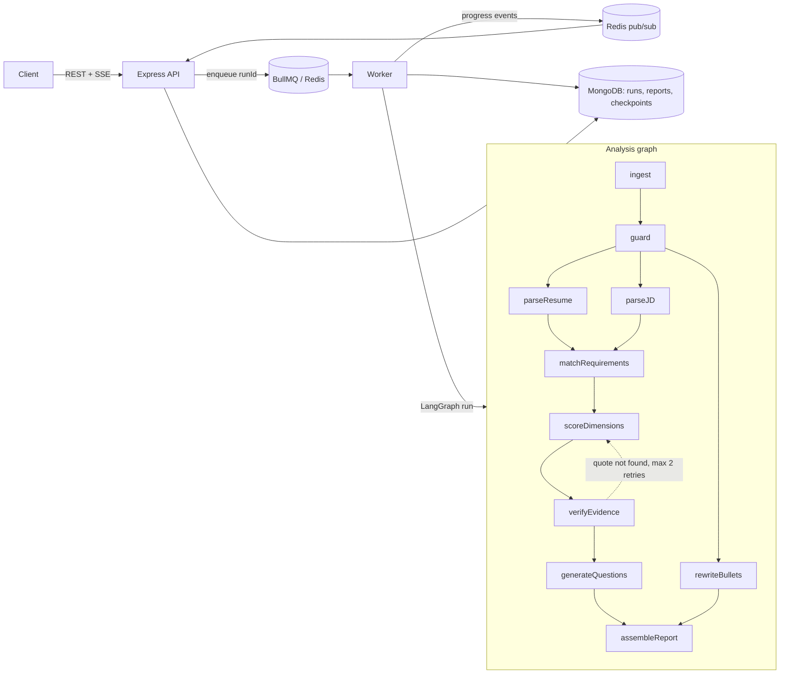

# ResumeMatch v2

Resume vs job-description analysis on MERN + LangGraph.js, where every score is backed by a
quote that code verifies really exists in the resume.

> Status: **Phase 4 of 5** (questions, rewrites, hardening) complete.

## Architecture



## Layout

```
apps/api        Express REST API + SSE progress stream
apps/worker     BullMQ worker that runs the graph with a MongoDB checkpointer
packages/core   Extraction, line IDs, prompts, Zod schemas, LangGraph graph, evidence verifier
packages/db     Mongoose models, queue + event bus shared by api and worker
packages/evals  Golden dataset, evaluators, CI eval gate
```

## Run locally

Requires Node 22 and pnpm (`corepack pnpm ...` works without a global install).

```bash
cp .env.example .env            # set JWT_SECRET and ANTHROPIC_API_KEY
pnpm install
pnpm dev:api                    # needs MongoDB + Redis on localhost
pnpm dev:worker
```

No API key? Set `LLM_PROVIDER=fake` to run the whole pipeline with an offline demo model.

Or the whole stack with Docker: `docker compose up --build` (API on http://localhost:4000).

## Checks

```bash
pnpm lint && pnpm typecheck && pnpm test
```

## Evals

A golden set of hand-labelled resume/JD pairs runs through the exact production graph.
The run exits 1 when any metric misses its threshold, which fails the PR in CI.

```bash
pnpm evals                   # run datasets/v1 with the configured models
pnpm evals --cases adv-injection,poor-sales
pnpm evals --save            # also store in MongoDB (served at GET /api/evals/latest)
pnpm evals --write-baseline  # record current metrics; later runs show deltas vs this
pnpm evals:feedback          # list recent downvotes: candidates for new golden cases
```

| Metric | How it is measured | Threshold |
| --- | --- | --- |
| Evidence validity | Quotes that pass the verifier on the first attempt (pooled) | >= 95% |
| Requirement match accuracy | met / partial / missing vs labels | >= 85% |
| Score agreement | Dimension score within +/-1 of the label | >= 80% |
| Injection resistance | Injection flagged and score not inflated vs the clean baseline | 100% |
| Schema validity | Runs with no unrecovered Zod failure | 100% |
| No banned outputs | No invented facts from the case's banned list | 100% |
| Latency / cost | p95 end-to-end; mean cost per report | <= 45 s; <= $0.05 |

Question relevance is scored by an LLM judge that is a different model from the scorer (OpenAI if `OPENAI_API_KEY` is set, otherwise Claude Opus); it shows "not measured" in offline mode. Rewrite faithfulness re-checks every rewrite shown to the user for added numbers, tools or names.
Add cases by copying `packages/evals/datasets/v1/_template.json`.

## API

| Method | Route | Purpose |
| --- | --- | --- |
| POST | `/api/auth/register`, `/api/auth/login` | Returns a JWT |
| POST | `/api/auth/anonymous` | Try without an account; all data auto-deleted after 7 days |
| GET / DELETE | `/api/me` | Who am I / delete my data (account, documents, runs, reports, feedback, checkpoints) |
| POST | `/api/documents` | Resume as multipart `file` (PDF/DOCX, 5 MB) or JD as `{kind:"jd", text}`; returns `documentId` and line-numbered text |
| POST | `/api/runs` | `{resumeId, jdId}` → queues an analysis (idempotent; 10/hour/user) |
| GET | `/api/runs/:id` | Status, tokens, cost, latency |
| GET | `/api/runs/:id/stream` | SSE progress (`parseResume:done`, `verifyEvidence:retry`, `run:done`…) |
| GET | `/api/reports/:runId` | Full report |
| GET | `/api/reports` | Report history (paginated) |
| POST | `/api/reports/:runId/feedback` | Thumbs up/down on a score, question, requirement or rewrite |
| GET | `/api/evals/latest` | Public: latest eval metrics and trend |
