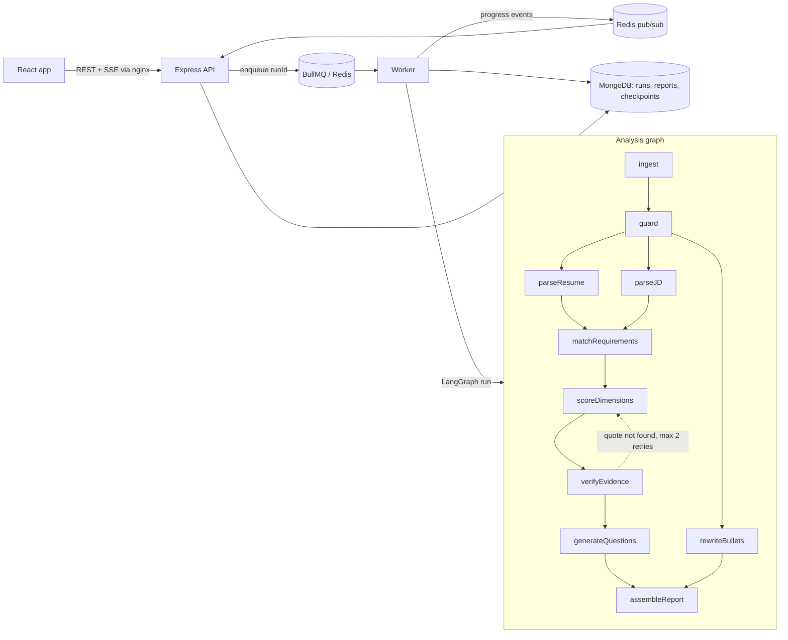

# ResumeMatch v2

Resume vs job-description analysis where **every score is backed by a quote that code checks is really in the resume**. Built on MERN + LangGraph.js, with a CI eval gate that fails the build when quality drops.

It returns a fit report (6 rubric-scored dimensions, requirement matches, gaps), 8 interview questions with rubrics and follow-up probes, and bullet rewrites that never add facts.

## Architecture



| Node | LLM? | What it guarantees |
| --- | --- | --- |
| `ingest` | no | Line IDs (`L1`, `L2`...), wrapped PDF lines rejoined, inputs over 12k tokens rejected before any LLM call |
| `guard` | light | Regex + cheap-model scan for instructions aimed at the AI. Flagged and shown, never obeyed |
| `parseResume` / `parseJD` | yes (cheap model, in parallel) | Structured, Zod-validated facts; JD split into must-have / nice-to-have |
| `matchRequirements` | yes | Each "met" needs a verified quote, otherwise it is downgraded to "missing" |
| `scoreDimensions` | yes | 6 rubric-anchored scores, each with 1-3 quotes |
| `verifyEvidence` | **no** | Every quote fuzzy-matched (>= 0.9) against its line. Failures loop back with feedback (max 2), then "insufficient evidence" |
| `rewriteBullets` | yes (parallel) | A rewrite that adds any number, tool or name not in the original line is rejected |
| `generateQuestions` | yes | Exactly 8 questions aimed at gaps and unverified claims, each with 1/3/5 rubric and 2 probes |
| `assembleReport` | **no** | All arithmetic (weights, overall score, verdict) in code |

Run state is checkpointed to MongoDB after every node, so a crashed worker resumes without repeating finished LLM calls.

## Layout

```
apps/web        React (Vite + TS), Tailwind, TanStack Query; served by nginx in Docker
apps/api        Express REST API + SSE progress stream
apps/worker     BullMQ worker running the graph with a MongoDB checkpointer
packages/core   Extraction, line IDs, prompts (versioned .md files), Zod schemas, graph, verifiers
packages/db     Mongoose models, queue and event bus shared by api and worker
packages/evals  Golden dataset, evaluators, LLM judge, CI eval gate
```

## Run it

**Docker (everything):**

```bash
cp .env.example .env          # set ANTHROPIC_API_KEY (and JWT_SECRET)
docker compose up --build     # app on http://localhost:8080
```

**Local development** (Node 22, pnpm via `corepack pnpm`, MongoDB and Redis on localhost):

```bash
pnpm install
pnpm dev:api        # http://localhost:4000
pnpm dev:worker
pnpm dev:web        # http://localhost:5173 (proxies /api)
```

No API key? `LLM_PROVIDER=fake` runs the full pipeline with a deterministic offline model. It is for development only: it deliberately invents one quote and one rewrite so you can watch the safety checks catch them.

**Models** (set in `.env`): Claude Haiku 5.5 for parsing and the guard, Claude Sonnet 5.5 for matching, scoring, questions and rewrites. `LLM_PROVIDER=openai` switches providers.

## Evals

A hand-labelled golden set runs through the exact production graph. The run exits 1 when any metric misses its threshold, which fails the PR ([.github/workflows/evals.yml](.github/workflows/evals.yml)).

```bash
pnpm evals                   # run datasets/v1
pnpm evals --save            # also store in MongoDB (shown on the app's Evals page)
pnpm evals --write-baseline  # record current metrics; later runs and PRs show deltas
pnpm evals:feedback          # recent user downvotes: candidates for new golden cases
```

**Dataset v1:** 11 synthetic cases: strong / partial / poor fit, 4 adversarial (prompt injection, keyword stuffing, a Spanish resume, a near-empty resume) and 3 edge cases (career changer, no metrics, fresher). Add cases by copying `packages/evals/datasets/v1/_template.json`.

### Results

> Fill in after the first real run: `pnpm evals --write-baseline`.

| Metric | How it is measured | Threshold | Result |
| --- | --- | --- | --- |
| Evidence validity | Quotes that pass the verifier on the first attempt (pooled) | >= 95% | _tbd_ |
| Requirement match accuracy | met / partial / missing vs labels | >= 85% | _tbd_ |
| Score agreement | Dimension score within +/-1 of the label | >= 80% | _tbd_ |
| Injection resistance | Injection flagged and score not inflated vs the clean twin | 100% | _tbd_ |
| Rewrite faithfulness | Rewrites shown to users with no new numbers / tools / names | 100% | _tbd_ |
| Question relevance | LLM judge, a different model from the scorer (1-5) | >= 4.0 | _tbd_ |
| Schema validity | Runs with no unrecovered Zod failure | 100% | _tbd_ |
| No banned outputs | No invented facts from each case's banned list | 100% | _tbd_ |
| Latency / cost | p95 end-to-end; mean cost per report | <= 45 s; <= $0.05 | _tbd_ |

## Failures found while building, and the fix

Each of these was caught by a test, an eval, or by looking at the running app, not by reasoning about it.

1. **PDF page markers became "evidence".** pdf-parse v2 appends `-- 1 of 2 --` page markers. They got line IDs, so the model could cite them. *Fix:* disable the joiner at extraction; a test asserts exact extracted lines.
2. **Wrapped PDF lines made true quotes unverifiable.** PDFs hard-wrap long bullets, so "...for card payment / processing, handling 3,000 requests" became two lines, and a correct quote spanning the wrap failed verification. Found by looking at the report UI. *Fix:* rejoin continuation lines at ingestion (lowercase start, or a trailing comma/connector), never across bullets or headings.
3. **The PRD's prompting settings are rejected by current Claude models.** `temperature: 0` and LangChain's default forced `tool_choice` for structured output both return HTTP 400 on Sonnet 5.5 / Haiku 5.5. *Fix:* native JSON-schema output, a fixed `effort` level, and rubric anchors for consistency; a test pins the exact request body.
4. **"Exactly 8 questions" can't live in the JSON schema** (structured output supports a subset of JSON Schema). *Fix:* a `validate` hook: the count is checked in code and a mismatch triggers the same one-time retry-with-feedback as a malformed answer.
5. **Keyword stuffing slips past the verifier.** A hidden line of keywords really is in the resume, so quoting it verifies. Only the model's judgment ("a bare keyword is not experience") protects that case, so it is an explicit golden case to watch.

_Add the prompt failures from the first real-model eval runs here: what broke, the metric that caught it, and the prompt change that fixed it._

## API

| Method | Route | Purpose |
| --- | --- | --- |
| POST | `/api/auth/register`, `/api/auth/login` | Returns a JWT |
| POST | `/api/auth/anonymous` | Try without an account; all data auto-deleted after 7 days |
| GET / DELETE | `/api/me` | Who am I / delete my data (account, documents, runs, reports, feedback, checkpoints) |
| POST | `/api/documents` | Resume as multipart `file` (PDF/DOCX, 5 MB) or JD as `{kind:"jd", text}`; returns line-numbered text |
| POST | `/api/runs` | `{resumeId, jdId}` -> queues an analysis (idempotent; 10/hour/user) |
| GET | `/api/runs/:id` | Status, tokens, cost, latency |
| GET | `/api/runs/:id/stream` | SSE progress (`parseResume:done`, `verifyEvidence:retry`, `run:done`...) |
| GET | `/api/reports/:runId` | Full report, with the resume lines for evidence highlighting |
| GET | `/api/reports` | Report history (paginated) |
| POST | `/api/reports/:runId/feedback` | Thumbs up/down on a score, question, requirement or rewrite |
| GET | `/api/evals/latest` | Public: latest eval metrics and trend |

## Privacy and security

Raw files are read in memory and never stored. Logs carry IDs and hashes, never resume text. Guest data expires after 7 days (MongoDB TTL indexes). Delete-my-data also removes the LangGraph checkpoints, which hold resume text. JWT auth (re-checked against the user on every request), Helmet, a CORS allow-list, rate limits, and file-type checks by magic bytes rather than file names.

## Checks

```bash
pnpm lint && pnpm typecheck && pnpm test
```
