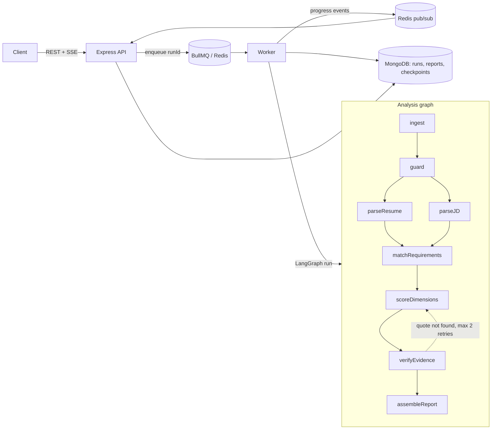

# ResumeMatch v2

Resume vs job-description analysis on MERN + LangGraph.js, where every score is backed by a
quote that code verifies really exists in the resume.

> Status: **Phase 2 of 5** (core LangGraph pipeline) complete.

## Architecture



## Layout

```
apps/api        Express REST API + SSE progress stream
apps/worker     BullMQ worker that runs the graph with a MongoDB checkpointer
packages/core   Extraction, line IDs, prompts, Zod schemas, LangGraph graph, evidence verifier
packages/db     Mongoose models, queue + event bus shared by api and worker
```

## Run locally

Requires Node 22 and pnpm (`corepack pnpm ...` works without a global install).

```bash
cp .env.example .env            # set JWT_SECRET and ANTHROPIC_API_KEY
pnpm install
pnpm dev:api                    # needs MongoDB + Redis on localhost
pnpm dev:worker
```

No API key? Set `LLM_PROVIDER=fake` to run the whole pipeline with an offline demo model.

Or the whole stack with Docker: `docker compose up --build` (API on http://localhost:4000).

## Checks

```bash
pnpm lint && pnpm typecheck && pnpm test
```

## API

| Method | Route | Purpose |
| --- | --- | --- |
| POST | `/api/auth/register`, `/api/auth/login` | Returns a JWT |
| POST | `/api/documents` | Resume as multipart `file` (PDF/DOCX, 5 MB) or JD as `{kind:"jd", text}`; returns `documentId` and line-numbered text |
| POST | `/api/runs` | `{resumeId, jdId}` → queues an analysis (idempotent; 10/hour/user) |
| GET | `/api/runs/:id` | Status, tokens, cost, latency |
| GET | `/api/runs/:id/stream` | SSE progress (`parseResume:done`, `verifyEvidence:retry`, `run:done`…) |
| GET | `/api/reports/:runId` | Full report |
| GET | `/api/reports` | Report history (paginated) |
